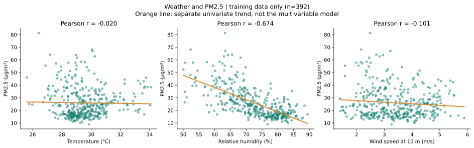
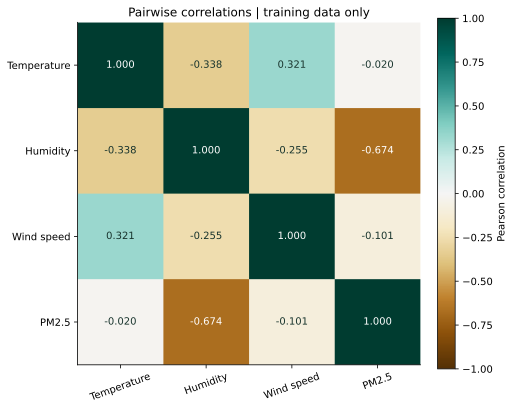
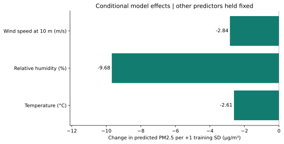
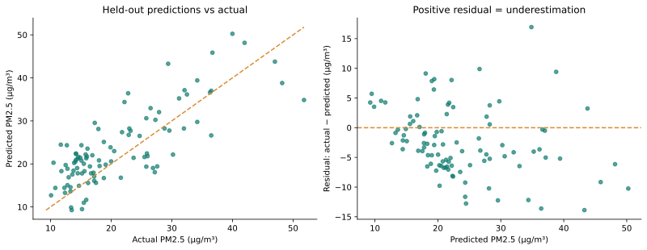
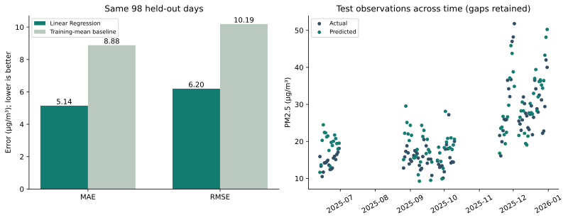
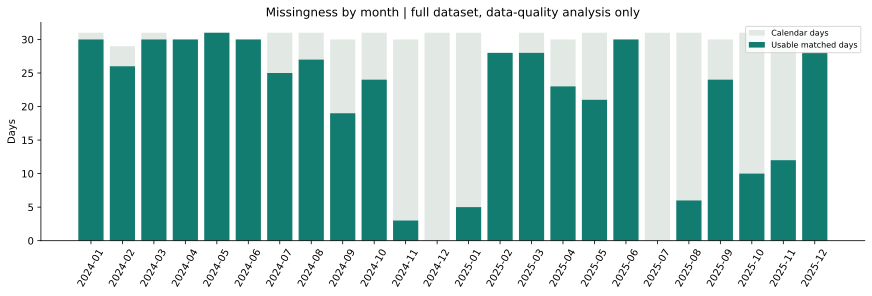

# การวิเคราะห์ข้อมูลและโมเดล AirPredict

โครงงานนี้ศึกษาว่าอุณหภูมิ ความชื้นสัมพัทธ์ และความเร็วลมช่วยประมาณ PM2.5 บริเวณโรงพยาบาลจุฬาลงกรณ์ได้เพียงใด ผลทดสอบย้อนหลังแสดงว่า Linear Regression มี MAE 5.14 µg/m³ ต่ำกว่าวิธีใช้ค่าเฉลี่ยชุดฝึก แต่ผลยังจำกัดด้วยข้อมูลที่ขาดตามฤดูกาลและพื้นที่ศึกษาเดียว

## ข้อมูลและวิธีวิเคราะห์

ใช้ข้อมูลจริงที่ผ่านเกณฑ์ 490 วันจากปี 2024–2025 โดยนำ PM2.5 จาก OpenAQ มาจับคู่กับอากาศ NASA POWER ในช่วงเวลาเดียวกัน หน่วยคืออุณหภูมิ °C ความชื้น % และลม m/s ที่ความสูง 10 เมตร คัดฝุ่นที่มี coverage อย่างน้อย 75% ไม่มี quality flag และไม่ติดลบ ต้องมีอากาศครบ 24 ชั่วโมง ไม่เติมค่าขาด

แบ่งตามเวลาเป็นชุดฝึก 392 วัน (2024-01-01 ถึง 2025-06-12) และชุดทดสอบ 98 วัน (2025-06-13 ถึง 2025-12-31) กราฟความสัมพันธ์และการตีความสัมประสิทธิ์ใช้ชุดฝึกเท่านั้น ส่วนชุดทดสอบใช้ประเมินโมเดลที่ตรึงไว้แล้ว ไม่มีการปรับโมเดลตามกราฟชุดทดสอบ

## ความสัมพันธ์ของสภาพอากาศกับ PM2.5



แต่ละจุดแทนวันหนึ่งในชุดฝึก เส้นสีส้มเป็นแนวโน้มเชิงเส้นที่วิเคราะห์ทีละตัวแปร ไม่ใช่เส้นของโมเดลหลายตัวแปร ค่า Pearson r วัดทิศทางและระดับความสัมพันธ์เชิงเส้นแบบจับคู่ ค่าติดลบหมายถึงในข้อมูลนี้ ตัวแปรที่สูงขึ้นมักพบร่วมกับ PM2.5 ที่ต่ำลง ไม่พิสูจน์ว่าตัวแปรนั้นเป็นสาเหตุให้ฝุ่นลด

| ตัวแปร | Pearson r กับ PM2.5 ในชุดฝึก | สัมประสิทธิ์ในหน่วยเดิม | ผลต่อ PM2.5 เมื่อเพิ่ม 1 SD ของชุดฝึก |
|---|---:|---:|---:|
| อุณหภูมิ | -0.020 | -1.7790 | -2.61 |
| ความชื้นสัมพัทธ์ | -0.674 | -1.1593 | -9.68 |
| ความเร็วลม | -0.101 | -2.9386 | -2.84 |

ผลที่พบในชุดฝึกคือความชื้นมีความสัมพันธ์เชิงเส้นแบบจับคู่กับ PM2.5 ชัดที่สุดในสามตัวแปร (r≈−0.674) ขณะที่อุณหภูมิ (r≈−0.020) และลม (r≈−0.101) มีความสัมพันธ์แบบจับคู่ค่อนข้างอ่อน โดยเฉพาะอุณหภูมิที่เกือบศูนย์ สัมประสิทธิ์อุณหภูมิในโมเดลหลายตัวแปรยังเป็นลบได้ เพราะเป็นความสัมพันธ์เมื่อคงตัวแปรอื่นไว้ ไม่ใช่การวัดแบบเดียวกับ Pearson r จึงไม่ควรอ้างจากสมการเพียงอย่างเดียวว่าอุณหภูมิสัมพันธ์กับฝุ่นแรง



กราฟนี้แสดงทั้งความสัมพันธ์กับฝุ่นและความสัมพันธ์ระหว่างตัวแปรอากาศเอง จึงช่วยอธิบายว่าค่า r แบบจับคู่อาจแตกต่างจากสัมประสิทธิ์ที่ควบคุมตัวแปรอื่นแล้ว ไม่ควรตีความว่าสหสัมพันธ์ต่ำแปลว่าไม่มีความสัมพันธ์ทุกรูปแบบ และยังไม่ได้รายงานนัยสำคัญทางสถิติหรือช่วงความเชื่อมั่น

## สมการ Linear Regression และความหมาย

```text
PM2.5 = 172.7018 − 1.7790 × T − 1.1593 × H − 2.9386 × W
T = อุณหภูมิเฉลี่ยรายวัน (°C)
H = ความชื้นสัมพัทธ์เฉลี่ยรายวัน (%)
W = ความเร็วลมเฉลี่ยรายวันที่ 10 เมตร (m/s)
ผลลัพธ์ = µg/m³
```

- เมื่อคงความชื้นและลมไว้เท่าเดิม อุณหภูมิเพิ่ม 1°C โมเดลให้ค่าฝุ่นลดลงประมาณ 1.7790 µg/m³
- เมื่อคงอุณหภูมิและลมไว้เท่าเดิม ความชื้นเพิ่ม 1 จุดเปอร์เซ็นต์ เช่น 70% เป็น 71% โมเดลให้ค่าฝุ่นลดลงประมาณ 1.1593 µg/m³
- เมื่อคงอุณหภูมิและความชื้นไว้เท่าเดิม ลมเพิ่ม 1 m/s โมเดลให้ค่าฝุ่นลดลงประมาณ 2.9386 µg/m³
- จุดตัดแกน 172.7018 คือค่าคำนวณเมื่อ T, H, W เป็นศูนย์ทั้งหมด ซึ่งอยู่นอกช่วงข้อมูลฝึก จึงไม่ควรตีความว่าเป็นค่าฝุ่นพื้นฐานจริงของกรุงเทพฯ

ตัวอย่าง T=30, H=70, W=2 แทนค่าแล้วได้ PM2.5 ประมาณ 32.30 µg/m³ ตัวเลขในสมการปัดเศษเพื่ออ่านง่าย โค้ดใช้สัมประสิทธิ์เต็ม



ห้ามเปรียบเทียบความสำคัญจากขนาดสัมประสิทธิ์ดิบโดยตรง เพราะตัวแปรใช้คนละหน่วย กราฟนี้ใช้สัมประสิทธิ์คูณส่วนเบี่ยงเบนมาตรฐานของตัวแปรในชุดฝึก เพื่อเทียบผลของการเพิ่มแต่ละตัวแปรหนึ่ง SD โดยคงตัวอื่นไว้ เป็นการสรุปพฤติกรรมของโมเดล ไม่ใช่ causal importance และไม่มีช่วงความเชื่อมั่น

## ผลทำนายและข้อผิดพลาด



ด้านซ้าย จุดใกล้เส้นทแยงหมายถึงค่าประมาณใกล้ค่าจริง ด้านขวา residual นิยามเป็นค่าจริงลบค่าประมาณ: บวกคือโมเดลประมาณต่ำไป ลบคือประมาณสูงไป ในชุดทดสอบ residual เฉลี่ย -2.36 µg/m³ และมี 28 วันที่ประมาณต่ำไป กับ 70 วันที่ประมาณสูงไป ค่าเฉลี่ยใกล้ศูนย์เพียงอย่างเดียวไม่ได้แปลว่าผิดพลาดน้อย เพราะค่าบวกและลบหักล้างกันได้

ค่า residual เฉลี่ยที่ติดลบประมาณ −2.36 และจำนวนวันที่ประมาณสูงไป 70/98 วัน ชี้ว่าโมเดลมีแนวโน้มประมาณสูงเกินจริงในชุดทดสอบนี้ แม้ MAE จะดีกว่า baseline จึงควรนำเสนออคติทิศทางนี้ควบคู่กับตัวเลขความคลาดเคลื่อน ไม่ปรับแก้โมเดลด้วยข้อมูลทดสอบชุดเดิมเพื่อทำให้ผลดูดีขึ้น



| ตัวชี้วัดชุดทดสอบ | Linear Regression | ค่าเฉลี่ยจากชุดฝึก |
|---|---:|---:|
| MAE (µg/m³) | 5.14 | 8.88 |
| RMSE (µg/m³) | 6.20 | 10.19 |
| R² | 0.529 | -0.273 |

โมเดลลด MAE จาก baseline ได้ประมาณ 42.1% บนวันทดสอบเดียวกัน MAE คือขนาดความผิดพลาดเฉลี่ย ไม่ใช่ช่วงรับประกันค่าทำนายรายครั้ง RMSE ให้น้ำหนักกับข้อผิดพลาดขนาดใหญ่มากกว่า ส่วน R²=0.529 หมายถึงอธิบายความแปรปรวนของ PM2.5 ในชุดทดสอบได้ประมาณ 52.9% ตามนิยาม R² ไม่ใช่ทำนายถูก 52.9% และ R² ของ baseline ติดลบได้เพราะใช้ค่าเฉลี่ยชุดฝึกแทนค่าเฉลี่ยชุดทดสอบ

## ความครบของข้อมูลและขอบเขตข้อสรุป



ข้อมูลขาดไม่เท่ากันตามเดือน โดย พ.ย. 2024 เหลือ 3 วัน ธ.ค. 2024 ไม่มีวันผ่านเกณฑ์ ม.ค. 2025 เหลือ 5 วัน และ ก.ค. 2025 ไม่มีวันผ่านเกณฑ์ จึงไม่สามารถอ้างว่าชุดข้อมูลแทนทุกฤดูกาลได้ดีเท่ากัน หรือว่าผลประเมินนี้ใช้แทนผลตลอดทั้งปีได้ นอกจากนี้ 98 วันทดสอบเป็น 98 วันที่มีข้อมูล ไม่ใช่ 98 วันปฏิทินติดต่อกัน

อากาศ NASA POWER เป็นข้อมูลกริด ไม่ใช่เครื่องวัดร่วม ณ จุดเดียวกับสถานีฝุ่น ตัวแปรที่ไม่ได้รวม เช่น แหล่งกำเนิดฝุ่น ฝน หรือสภาพการกระจายตัวของอากาศ อาจสัมพันธ์กับความผิดพลาด แต่การทดลองนี้ยังไม่ได้ทดสอบอิทธิพลของตัวแปรเหล่านั้น และไม่ได้ทำ validation หลายช่วงเวลา

ข้อสรุปที่รองรับได้คือ โมเดลเชิงเส้นที่ใช้ตัวแปรอากาศสามตัวประมาณฝุ่นได้ดีกว่า baseline ค่าเฉลี่ยในการแบ่งข้อมูลครั้งนี้ ผลเป็นการประมาณย้อนหลังจากอากาศเฉลี่ยของวันเดียวกัน ไม่ใช่พยากรณ์อนาคต ไม่ควรตีความความสัมพันธ์เป็นเหตุและผลหรือรับรองการใช้กับพื้นที่อื่น

## วิธีสร้างผลซ้ำและที่มาข้อมูล

หลังเตรียมข้อมูลและฝึกโมเดลตาม README ให้รัน:

```powershell
.\.venv\Scripts\python.exe scripts\analyze_results.py
```

สคริปต์อ่าน data/processed/airpredict_daily.csv, reports/metrics.json และ reports/test_predictions.csv แล้วสร้างรูป PNG/SVG และ analysis_statistics.json โดยไม่ฝึกหรือปรับโมเดลใหม่

- [OpenAQ](https://docs.openaq.org/) — location 5545, sensor 1304222
- [NASA POWER Hourly API](https://power.larc.nasa.gov/docs/services/api/temporal/hourly/) — UTC, T2M/RH2M/WS10M
- โค้ดและขั้นตอน: scripts/check_coverage.py, prepare_dataset.py, train_model.py และ analyze_results.py ใน repository
